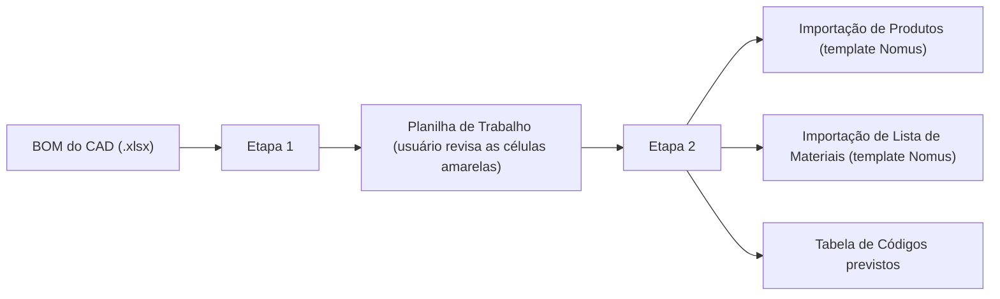

# CONTEXTO DO PROJETO — Automação BOM CAD → ERP Nomus

> **Leia este arquivo inteiro antes de mexer no projeto.** Ele vale para qualquer IA ou desenvolvedor.
> É a fonte de verdade sobre o objetivo, as regras de negócio, as decisões já tomadas com o usuário e as pendências.
> Idioma do projeto: **português (Brasil)**. Responda o usuário em português.

---

## 1. Quem é o usuário e qual é o problema

- O usuário trabalha na **engenharia** de uma fábrica de máquinas (trituradores como TS-55 e TS-65).
- Ele modela no **CAD 3D (SolidWorks)** e cria **propriedades personalizadas** nas peças. A partir delas exporta um **BOM em Excel**.
- O ERP da empresa é o **Nomus**. Para cadastrar uma máquina nova ele precisa importar **duas planilhas** no Nomus, usando os templates oficiais:
  1. **Importação de Produtos**: cria os produtos. O Nomus gera o código a partir do *tipo de código estruturado* + atributos.
  2. **Importação de Lista de Materiais**: monta a estrutura pai → filho da máquina.
- **Hoje tudo é manual e demorado.** Ele copia o BOM, coloca cada campo na coluna certa e acrescenta linhas que o CAD não tem: tratamento térmico, serviços de terceiros, matéria-prima, etapas de usinagem/solda. Também preenche à mão família, método de ressuprimento, setores de estoque, política etc. Depois monta a lista de materiais item a item.

## 2. Objetivo

Criar um programa que, **a partir do BOM do CAD**, gere as duas planilhas prontas para importar, com **o mínimo possível de edição manual**:

1. Destrinchar o BOM e gerar os produtos, incluindo as linhas derivadas: serviços, matéria-prima e etapas.
2. **Prever o código** que o Nomus vai gerar para cada produto e mostrar numa tabela.
3. Gerar a **lista de materiais completa da máquina** a partir da coluna **ITEM** do CAD, usando esses códigos.

## 3. Formato da solução (decidido)

- **Linguagem:** Python 3 (Python 3.14 já instalado; usar o comando `py` no Windows). Bibliotecas: `openpyxl` (já instalada) e `pandas`.
- **Interface:** janela simples (Tkinter) com:
  - seleção de arquivo;
  - campo **Código da máquina** (ex.: `TS-65`);
  - botão **"Etapa 1 – Gerar Planilha de Trabalho"**;
  - botão **"Etapa 2 – Gerar arquivos de importação"**.
- **Distribuição:** empacotar como **`.exe`** (PyInstaller) para rodar sem instalar nada.
- **Configuração:** tabelas de regras em **arquivo editável** (YAML/JSON ou Excel de configuração): sufixos, serviços, valores fixos, mapeamentos. O usuário precisa poder incluir novos serviços ou sufixos sem mexer no código.
- **Pasta do projeto (workspace):** `C:\Users\Engenharia1\.gemini\antigravity\scratch\automacao_bom_nomus`

### Fluxo em 2 etapas



- **Planilha de Trabalho:** é a ÚNICA planilha que o usuário edita. Ela contém:
  - ITEM, PAI, QTD, código previsto, todos os campos do produto, uma coluna de **alertas** e as células **em amarelo** onde há dúvida.
  - O usuário pode adicionar, remover ou alterar linhas.
- **Etapa 2:** lê a Planilha de Trabalho revisada e gera os arquivos finais **no template oficial do Nomus**, mantendo abas e ordem das abas. Não alterar a ordem das abas: o Nomus exige.
- **Saída limpa:** sem TAB, sem espaços no início ou no fim dos códigos. As planilhas validadas pelo usuário têm vários `\t` e espaços sobrando; a automação deve evitar isso.

## 4. Arquivos de referência (em `dados_referencia/`)

| Arquivo | O que é |
|---|---|
| `TEMPLATE_Importacao_Produtos.xlsx` | Template oficial Nomus de produtos. Aba "Cadastro de Produtos", 48 colunas padrão + atributos personalizados |
| `TEMPLATE_Importacao_Lista_Materiais.xlsx` | Template oficial Nomus de lista de materiais. Aba "Importação de lista de material", 10 colunas |
| `TS-55_Produtos_VALIDADO.xlsx` | Produtos da TS-55, já importados e 100% corretos (146 produtos) |
| `TS-55_Lista_Materiais_VALIDADO.xlsx` | Lista da TS-55, 100% correta (215 linhas) |
| `TS-65_BOM_CAD.xlsx` | **Entrada real**: BOM exportado do CAD da TS-65 |
| `TS-65_Produtos_VALIDADO.xlsx` | Produtos da TS-65 validados (148 produtos) — **gabarito principal** |
| `TS-65_Lista_Materiais_VALIDADO.xlsx` | Lista da TS-65 validada (~330 linhas) — **gabarito principal** |

> **Validação:** rodar o programa em `TS-65_BOM_CAD.xlsx` e comparar com os dois arquivos `TS-65_*_VALIDADO`. A **TS-65 é a referência mais recente**. Quando TS-55 e TS-65 divergirem, vale a TS-65 (ver seção 12).
> Itens comerciais e o painel elétrico estão no gabarito, mas ficam **fora do escopo** (ver 9). Ignore-os na comparação.

## 5. Formato do BOM do CAD (entrada)

- Planilha única. **Cabeçalho na ÚLTIMA linha útil** (linha 230), com "Tabela BOM" abaixo. As linhas vêm em **ordem inversa** (do último item para o primeiro).
- Colunas, de A a M:

| Col | Nome | Observação |
|---|---|---|
| A | ITEM | Hierarquia: `4`, `4.65`, `4.65. 11` (**pode ter espaço depois do ponto**; normalizar) |
| B | TIPO DE CÓDIGO ESTRUTURADO | COMPONENTE, ITEM DE CORTE, COMPONENTE COMERCIAL, ROLAMENTO ou vazio |
| C | Descrição Rotex | Descrição do produto |
| D | UNIDADE DE MEDIDA | UNID |
| E | TIPO DE PRODUTO | CONJUNTO SOLDADO, CONJUNTO USINADO, PRODUTO SEMI-ACABADO, MATERIA PRIMA |
| F | FAMILIA DE PRODUTO | COMPONENTE DE MAQUINA, COMPONENTES COMERCIAIS |
| G | METODO DE RESSUPRIMENTO | COMO PADRÃO FABRICADO / COMPRADO (às vezes com quebra de linha no meio) |
| H | N° do Desenho (arquivo) | Base do código (num_desenho) |
| I | N° do Desenho (Configuração) | Geralmente "Valor predeterminado", "Default", "0" ou "<Como usinado>"; **ignorar** |
| J | TIPO DE CORTE | OXICORTE, CORTE LASER, CORTE E DOBRA |
| K | TIPO DE SERVIÇO | ALÍVIO DE TENSÃO, TÊMPERA E REVENIMENTO, USINAGEM… |
| L | DIMENSOES | Texto livre: `Ø 255 x 25`, `Red. Forj. 228 x 2376`, `Chapa 50.8x105x490`, `Conf. Lista` |
| M | QTD | Quantidade **por conjunto pai** |

- Textos podem ter **quebras de linha e espaços duplos** (ex.: `COMO PADRÃO\nFABRICADO`). Normalizar antes de comparar.
- **Configurações da mesma peça:** o usuário vai preencher no CAD o num_desenho final já com a variação (ex.: `F65-004-030`). A automação usa o num_desenho direto.

## 6. Template de Produtos — colunas usadas

Colunas preenchidas (as demais ficam vazias). **"Codigo do produto" fica VAZIO**: o Nomus gera o código.

| Col | Campo | Regra |
|---|---|---|
| B | Tipo de código estruturado | COMPONENTE / ITEM DE CORTE / PEÇA DE SERVIÇO EM TERCEIRO / AÇO REDONDO |
| E | Descricao do produto | Do CAD, **exatamente como está**. Itens gerados pela automação ficam **em branco** (usuário preenche) |
| F | Unidade de medida | `UNID` |
| G | Tipo de produto | Ver 7.3 |
| H | Grupo de produto | Só para aço: `SAE 4140`, `SAE 4340`, `SAE 1045`, `SAE 4320`… |
| I | Familia de produto | `COMPONENTE DE MAQUINA`; aço = `AÇO LIGA`; estrutura tubular = `COMPONENTES COMERCIAIS` (segue o CAD) |
| J | Metodo de ressuprimento | Ver 7.3 |
| P | Empresas | `01` |
| Q | Setores de estoque | `01,02` (padrão TS-65) |
| R | Setor de estoque padrão | `02` |
| U | NCM | `84378010` |
| W | Origem do produto | `0` |
| AB | Politica de ressuprimento | `Ressuprimento sob encomenda sem consulta ao estoque` |
| AW | num_desenho | atributo personalizado |
| AX | tipo_corte | OXICORTE / CORTE LASER / CORTE E DOBRA |
| AY | tipo_servico | ALÍVIO DE TENSÃO / TÊMPERA E REVENIMENTO / TÊMPERA E CEMENTAÇÃO / FRESAMENTO E ENTALHE / CALANDRA… |
| AZ | tipo_aço | LAMINADO / FORJADO |
| BA | formato | REDONDO |
| BB | diametro | número |
| BC | comprimento | número |

## 7. Regras de negócio

### 7.1 Previsão do código (`código = num_desenho + sufixo`)

| Condição | Sufixo | Exemplo |
|---|---|---|
| Conjunto soldado | `-C` | `209-001-001-C` |
| Conjunto usinado | `-U` | `065-028-000-U` |
| Produto semi-acabado / conjunto montado | `-SA` | `209-000-001-SA` |
| Corte laser | `-CL` | `065-230-001-CL` |
| Oxicorte | `-OXI` | `209-001-000-1-OXI` |
| Corte e dobra | `-CD` | `209-012-001-14-CD` |
| Tubo / matéria-prima componente | `-MP` | `065-030-002-MP` |
| Alívio de tensão | `-ALT` | `209-001-000-ALT` |
| Têmpera e revenimento | `-TR` | `065-028-000-TR` |
| Têmpera e cementação | `-TC` (TS-65; na TS-55 era `-STRC`) | `209-030-001-TC` |
| Fresamento e entalhe | `-FRE-EN` | `209-030-001-FRE-EN` |
| Calandra | `-CAL` | `023-807-000_1-CAL` |

- O código é sempre **em maiúsculas** (o CAD às vezes traz `1090t41-003`).
- O produto da máquina (ex.: `TS-65`) **já existe** no Nomus: não é criado, só é a raiz da lista.

### 7.2 Matéria-prima (código no padrão TS-65)

Formato: `<FAMÍLIA>-<GRUPO>-<LAM|FORJ|FUND>-<FORMATO>-<DIMENSÕES>`

| Exemplo | Significado |
|---|---|
| `AL-SAE 4140-LAM-RE-Ø255 X 25` | Aço liga, laminado, redondo, Ø × comprimento |
| `AL-SAE 4340-FORJ-RE-Ø460 X 140` | Aço liga, forjado, redondo |
| `AC-SAE 1045-LAM-RE-Ø440 X 80` | Aço carbono, redondo |
| `AC-SAE 1020-FORJ-DS-Ø410 X Ø300 X 25,4` | Disco (Ø ext × Ø int × espessura) |
| `AC-ASTM A36-LAM-BR-50,8 X 105 X 490` | Barra retangular |
| `AC-SAE 1020-FORJ-CH-80 X 140 X 165` | Chapa/bloco |
| `BR-SAE 620-FUND-BCH-Ø120 X Ø100 X 60` | Bronze fundido, bucha |
| `CE-TB-150 X 150 X 6000` | Tubo comercial |

- Regras de interpretação de **DIMENSOES** (decidido):
  - `Red. Forj.` / `RED. FORJ` → FORJADO;
  - só `Ø` → LAMINADO;
  - texto não interpretável (ex.: `Conf. Lista`) → **amarelo**.
- **O grupo (SAE 4140/4340/1045…) NÃO vem do CAD.** Usar um padrão configurável e **sempre marcar em amarelo** para o usuário confirmar. Na TS-65 houve 1045, 4140 e 4340 em peças parecidas, então não dá para adivinhar.
- Na planilha de Produtos, só a matéria-prima **AÇO REDONDO** nova é criada (tipo_aço, formato, diâmetro, comprimento). Discos, barras e chapas já existiam no Nomus e entram só na lista de materiais.
- Atenção: o código pode usar uma dimensão **com sobremetal** diferente da peça (ex.: pino Ø25 × 107 → `AL-SAE 4140-LAM-RE-Ø26 X 107`). O usuário ajusta na Planilha de Trabalho.

### 7.3 Tipo de produto e método de ressuprimento (padrão TS-65)

| Situação | Tipo de produto | Método |
|---|---|---|
| Soldado | `CONJUNTO SOLDADO` | Como padrão fabricado |
| Usinado | `CONJUNTO USINADO` | Como padrão fabricado |
| Semi-acabado / conjunto | `PRODUTO SEMI-ACABADO` | Como padrão fabricado |
| Item de corte | `MATERIA PRIMA` | Como padrão comprado |
| Aço redondo | `MATERIA PRIMA` | Como padrão comprado |
| Peça de serviço em terceiro (ALT/TR/TC…) | `PRODUTO SEMI-ACABADO` (TS-65; na TS-55 era `Produzido em Terceiros`) | Como padrão comprado |

- Exceção vista no gabarito: `BASE - TS-65 - USINAGEM` (usinagem terceirizada) está como **comprado** e leva o serviço `SERV-US` na lista.

### 7.4 Estrutura da lista de materiais

- **Raiz:** `<MÁQUINA>` (ex.: `TS-65`). Os itens de nível 1 do CAD são filhos diretos dela.
- Nome da lista = Descrição da lista = `<MÁQUINA>-001`. Qtde base = `1`, Posição = `1`, Recebe componente = `0`.
- A hierarquia segue a **coluna ITEM** do CAD: `4.65. 3` é filho de `4.65`, que é filho de `4`.
- **QTD** = quantidade por conjunto pai. Itens gerados pela automação (serviço, etapa, matéria-prima) entram com **qtde 1**.
- **Duplicidade** (o mesmo filho mais de uma vez sob o mesmo pai): **não somar**. Sinalizar em amarelo para o usuário corrigir.

**Cadeias de processo padrão.** A automação aplica o padrão e o usuário ajusta as exceções:

```
Soldado com alívio de tensão (caixa, frente, lateral):
  X-U  →  X-ALT  →  Y-C  →  chapas -OXI/-CL
               └→ SERV-TTERM-ALT

Usinado de barra com têmpera (anéis, buchas, facas, separadores):
  X-TR  →  X-U  →  matéria-prima (aço) ou item de corte -OXI
     └→ SERV-TTERM-TR

Engrenagem (têmpera e cementação + fresamento):
  X-TC  →  X-FRE-EN  →  aço
     │          └→ SERV-US-FRE-EN
     └→ SERV-TTERM-TC

Usinado de chapa (suporte, placa de sacrifício, raspadores):
  X-U  →  X-OXI (item de corte; tipo de corte vem de propriedade do CAD, nunca assumir)

Usinado simples de barra:
  X-U  →  aço
```

- **Exceção conhecida:** eixos `065-016-000` e `065-017-000` usam `X-U → X-TR → aço` (a têmpera vem ANTES da usinagem final). Isso é ajuste manual.
- **Usinagem × solda da mesma peça:** podem ter **num_desenho diferentes** (ex.: `209-001-000-U` usinagem e `209-001-001-C` solda) e no CAD podem aparecer como **irmãos** (`4.1` e `4.65`) ou **invertidos** (`8 BASE SOLDA` com filho `8.1 BASE USINAGEM`). No ERP o certo é sempre **U como pai de (serviço →) C**.
  - Regra: seguir a hierarquia do CAD. Quando houver uma Usinagem sem filhos e uma Solda "irmã" da mesma raiz de desenho (ex.: `209-001-xxx`), **sugerir o vínculo e marcar em amarelo**.
  - O mesmo vale para um usinado e o seu item de corte irmão (ex.: `4.24 PLACA DE SACRIFÍCIO - USINAGEM 065-022-000` + `4.67 ... OXICORTE 065-022-001`).
- **Peças compartilhadas:** as 4 facas (`F65-004-030/042/054/066-U`) usam o mesmo item de corte `F65-004-000-OXI` e o mesmo serviço `F65-004-000` de tratamento.
- **Vários serviços na mesma peça** (engrenagem): caso raro. A automação aplica um serviço e o usuário completa o resto manualmente.

### 7.5 Códigos de serviço (arquivo de configuração)

| Serviço | Código do serviço (filho da etapa) |
|---|---|
| ALÍVIO DE TENSÃO | `SERV-TTERM-ALT` (TS-65; na TS-55 era `SERV-TTERM-TR`) |
| TÊMPERA E REVENIMENTO | `SERV-TTERM-TR` |
| TÊMPERA E CEMENTAÇÃO | `SERV-TTERM-TC` (TS-55: `SERV-TTERM-TRC`) |
| FRESAMENTO E ENTALHE | `SERV-US-FRE-EN` |
| CALANDRA | `SERV-CAL` |
| USINAGEM EM TERCEIRO | `SERV-US` |
| MONTAGEM DE PAINEL | `SERV-MONT-PNL` |

### 7.6 Flag "Remete componente para industrialização em terceiros"

- Vale `1` nas linhas ligadas a etapas de terceiro e `0` no resto. **A posição exata está PENDENTE** (ver 12.1).

## 8. Alertas (células amarelas na Planilha de Trabalho)

Marcar em amarelo, com o motivo na coluna de alertas:

- linha **sem TIPO DE CÓDIGO** (decidido: **toda** linha sem tipo vai para a Planilha de Trabalho em amarelo, inclusive as peças `.stp` de subconjuntos comerciais);
- DIMENSOES não interpretável e grupo de aço (sempre);
- vínculo sugerido entre Usinagem e Solda irmãs;
- filho duplicado sob o mesmo pai;
- código previsto repetido entre produtos diferentes (colisão);
- descrição vazia em item gerado (o usuário preenche);
- serviço desconhecido (não está na configuração).

## 9. Fora do escopo (decidido)

- **Itens comerciais** (parafusos `FIX-…`, rolamentos `ROL-…`, retentores `RT-…`, o-rings `OR-…`, `CC-…`, motor `MTR-…`, redutor `RED-EP…`) e o **painel elétrico**: o usuário adiciona manualmente na lista de materiais. O CAD traz esses itens com nomes de biblioteca (`hex bolt_am`, `23040emw33`) que não batem com o Nomus.
- **Checar produtos que já existem no Nomus:** não precisa. O Nomus ignora/rejeita duplicados na importação.
- Consumíveis com quantidade fracionária (`0.25`, `0.023`, `0.075`) são ajuste manual.

## 10. Estrutura sugerida do código

```
automacao_bom_nomus/
├── CONTEXTO_PROJETO.md        ← este arquivo
├── dados_referencia/          ← templates + gabaritos (não alterar)
├── config/
│   └── regras.yaml            ← sufixos, serviços, valores fixos, mapeamentos, grupo de aço padrão
├── src/
│   ├── leitor_cad.py          ← lê e normaliza o BOM do CAD (cabeçalho no fim, ordem inversa, ITEM)
│   ├── regras.py              ← sufixos, cadeias de processo, matéria-prima, serviços
│   ├── planilha_trabalho.py   ← gera/lê a Planilha de Trabalho (amarelos + alertas)
│   ├── exportador_nomus.py    ← escreve nos templates oficiais (produtos + lista + tabela de códigos)
│   └── app.py                 ← interface Tkinter
├── tests/
│   └── test_ts65.py           ← compara a saída com os gabaritos TS-65 (ignorando comerciais)
└── build_exe.bat              ← PyInstaller
```

## 11. Critérios de aceite

1. Na TS-65, os **códigos previstos** dos produtos de engenharia batem com o gabarito. Diferenças só nos casos marcados em amarelo.
2. A **lista de materiais** gerada (sem comerciais/painel) reproduz as relações pai → filho e as quantidades do gabarito, exceto os ajustes manuais documentados (seção 7.4).
3. Os arquivos finais abrem no template oficial, sem TAB ou espaço sobrando, e importam no Nomus sem erro.
4. O usuário só precisa mexer nas células amarelas.

## 12. Divergências e pendências (confirmar com o usuário antes de fechar a regra)

### 12.1 Posição do flag "Remete = 1" — **PENDENTE**

- **TS-55:** o `1` está na linha **filho da etapa de terceiro**. Exemplo: pai `023-054-000-TR`, filho `023-054-000-U`, Remete `1`.
- **TS-65:** o `1` está na linha em que a **etapa de terceiro é o filho**. Exemplos: pai `209-000-001-SA`, filho `065-028-000-TR`, Remete `1`; e pai `209-001-000-U`, filho `209-001-000-ALT`, Remete `1`.
- Nas engrenagens da TS-65 aparecem os dois padrões ao mesmo tempo.
- Perguntar qual é o correto. Até lá, deixar configurável e seguir a TS-65.

### 12.2 Diferenças TS-55 × TS-65 (assumido que a TS-65 é o padrão atual)

| Item | TS-55 | TS-65 |
|---|---|---|
| Setores de estoque | `02` | `01,02` |
| Origem do produto | vazio | `0` |
| Tipo de produto | estilo Nomus (`Usinado`, `Soldado`, `Produzido em Terceiros`) | estilo CAD (`CONJUNTO USINADO`, `CONJUNTO SOLDADO`, `PRODUTO SEMI-ACABADO`) |
| Serviço do alívio de tensão | `SERV-TTERM-TR` | `SERV-TTERM-ALT` |
| Código de matéria-prima | `AL-SAE 4140-RE-D.215 X 50` | `AL-SAE 4140-LAM-RE-Ø215 X 50` |
| Têmpera + cementação | `-STRC` / `SERV-TTERM-TRC` | `-TC` / `SERV-TTERM-TC` |

### 12.3 Outros pontos a confirmar

- `065-031-000-1U` (num_desenho no cadastro) × `065-031-000-1-U` (código na lista): inconsistência no gabarito.
- `1090t41-000` no CAD × `065-1090T41-000-SA` no gabarito: renomeação manual.
- Quantidades no gabarito diferentes do CAD (ex.: suporte dos raspadores 4 → 12; facas 4 → 5): correções feitas pelo usuário depois de exportar.

## 13. Histórico de decisões (resumo da entrevista com o usuário)

1. Validar contra uma máquina com o par completo (CAD + validadas): **TS-65**.
2. A regra de sufixos deduzida está correta. A automação deve replicá-la para prever os códigos.
3. A ordem das etapas varia: aplicar o padrão e o usuário ajusta as exceções.
4. Aço redondo: interpretar DIMENSOES (forjado/laminado). O que não der fica amarelo.
5. Usinado de chapa gera um item de corte filho, com o **tipo de corte vindo de propriedade do CAD**.
6. Itens comerciais ficam fora da automação.
7. Não checar produtos já existentes (o Nomus trata).
8. Hierarquia: o ITEM do CAD é a verdade. Usinagem e Solda irmãs geram um vínculo sugerido em amarelo.
9. Interface: Python com janela simples, empacotado em `.exe`.
10. Fluxo com Planilha de Trabalho intermediária. A Etapa 2 gera os 3 arquivos finais.
11. O programa pede o código da máquina. A lista se chama `<MÁQUINA>-001`. A máquina já existe no Nomus.
12. Configurações de peça: o usuário coloca o num_desenho final no CAD.
13. Descrição: a do CAD, exatamente. Itens gerados ficam em branco.
14. Corte e dobra = `-CD`.
15. Valores fixos e método de ressuprimento ficam em arquivo de configuração.
16. Duplicidades são só sinalizadas. O usuário corrige a quantidade.
17. A tabela de serviços fica em arquivo de configuração e é editável.
18. Vários serviços na mesma peça: aplicar um, o resto é manual.
19. Linha sem tipo de código vai **sempre** para a Planilha de Trabalho em amarelo.
20. Erro na lista validada da TS-55 (`201-030-004-STRC` → `201-030-001-FRE-EN`): o usuário confirmou e já corrigiu no sistema.

## 14. Status atual

- [x] Entrevista de requisitos concluída
- [x] Arquivos de referência organizados em `dados_referencia/`
- [x] Análise do gabarito TS-65 (divergências na seção 12)
- [x] Confirmar com o usuário as pendências da seção 12 (`Remete = 1` no componente bruto enviado ao terceiro, ex: `Pai = 065-028-000-TR, Filho = 065-028-000-U, Remete = 1`)
- [x] Implementar `leitor_cad.py` + `regras.py` + `config/regras.json`
- [x] Implementar a Planilha de Trabalho (Etapa 1) em `planilha_trabalho.py`
- [x] Implementar o exportador Nomus (Etapa 2) em `exportador_nomus.py`
- [x] Testes contra o gabarito TS-65 (`tests/test_ts65.py`) e geração dos arquivos na pasta `output/`
- [x] Interface Tkinter (`src/app.py`) + atalho `Iniciar_Automacao_Nomus.bat` + script `build_exe.bat`

