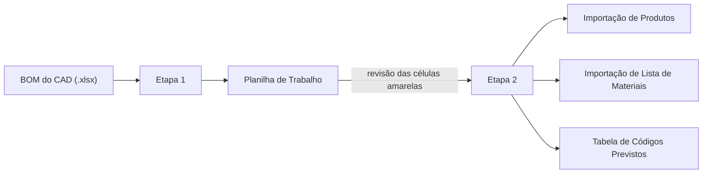

# Automação BOM CAD → ERP Nomus

Ferramenta desktop em Python que transforma o **BOM exportado do SolidWorks** em duas planilhas prontas para importar no **ERP Nomus**:

- **Importação de Produtos**: cadastra os produtos, que o Nomus codifica pelo *tipo de código estruturado*.
- **Importação de Lista de Materiais**: monta a estrutura pai → filho da máquina.

A ferramenta também gera uma **Tabela de Códigos Previstos**, para conferir antes de importar.

O objetivo é eliminar o trabalho manual de copiar o BOM, criar as linhas que o CAD não tem (tratamentos térmicos, serviços de terceiros, matéria-prima, etapas de usinagem/solda) e preencher campos fixos. O usuário revisa apenas as células marcadas em amarelo.

---

## Sumário

- [Como funciona](#como-funciona)
- [Requisitos](#requisitos)
- [Instalação](#instalação)
- [Uso](#uso)
- [Formato do BOM de entrada](#formato-do-bom-de-entrada)
- [Regras de negócio](#regras-de-negócio)
- [Configuração](#configuração)
- [Estrutura do projeto](#estrutura-do-projeto)
- [Testes e validação](#testes-e-validação)
- [Gerar o executável (.exe)](#gerar-o-executável-exe)
- [Limitações conhecidas](#limitações-conhecidas)
- [Fora do escopo](#fora-do-escopo)

---

## Como funciona

O processo tem **duas etapas**, com uma revisão manual entre elas:



| Etapa | Entrada | Saída |
|---|---|---|
| **1** | BOM do CAD + código da máquina (ex.: `TS-65`) | `Planilha_Trabalho_<MAQUINA>.xlsx`, com a estrutura completa, os códigos previstos e os alertas |
| **Revisão** | Planilha de Trabalho | O usuário ajusta só o que estiver em amarelo: descrições de itens gerados, grupo do aço, vínculos sugeridos |
| **2** | Planilha de Trabalho revisada | Os 3 arquivos finais, gravados nos **templates oficiais do Nomus** |

A Planilha de Trabalho é a **única** planilha que o usuário edita. Nela é possível alterar, incluir ou excluir linhas livremente.

---

## Requisitos

- Windows
- Python **3.10+** (desenvolvido e testado com 3.14)
- [`openpyxl`](https://pypi.org/project/openpyxl/)
- Tkinter (já incluso no instalador oficial do Python para Windows)

---

## Instalação

```powershell
git clone <url-do-repositorio>
cd automacao_bom_nomus
py -m pip install openpyxl
```

> [!IMPORTANT]
> Os templates oficiais do Nomus precisam estar em `dados_referencia/`:
> - `TEMPLATE_Importacao_Produtos.xlsx`
> - `TEMPLATE_Importacao_Lista_Materiais.xlsx`
>
> A Etapa 2 copia esses arquivos para gerar a saída, preservando as abas e a ordem delas, como o Nomus exige.

---

## Uso

### Interface gráfica

Dê duplo clique em **`Iniciar_Automacao_Nomus.bat`** ou rode:

```powershell
py src\app.py
```

1. Informe o **Código da Máquina** exatamente como está no Nomus (ex.: `TS-80`). A lista será criada como `TS-80-001`.
2. Escolha a **Pasta de Saída**. O padrão é `output/`.
3. **Etapa 1:** selecione o BOM do CAD e clique em **"Etapa 1 – Gerar Planilha de Trabalho"**.
4. Abra a Planilha de Trabalho no Excel e revise:

   | Cor | Significado | O que fazer |
   |---|---|---|
   | 🟩 Verde | Linha gerada automaticamente (serviço, matéria-prima, corte) | Preencher a descrição e, no aço redondo, confirmar o grupo (SAE 4140 / 1045 / 4340…) |
   | 🟨 Amarelo forte | Campo que precisa de confirmação; o motivo está na coluna **ALERTAS / REVISÃO** | Conferir e corrigir |
   | 🟨 Amarelo claro / cinza | Item sem tipo de código ou comercial; vem marcado como `NAO` | Mudar para `SIM` se for peça de engenharia |

   > Se você alterar `num_desenho`, `tipo_corte`, `tipo_servico` ou os dados do aço e **apagar** o conteúdo de `Código Filho / Previsto`, a Etapa 2 recalcula o código.

5. Salve a planilha, volte ao programa e clique em **"Etapa 2 – Gerar Arquivos de Importação Nomus"**.
6. No Nomus: **Arquivos Importados Engenharia → Importar novo arquivo**.
   - Importe **primeiro os Produtos** e depois a **Lista de Materiais**.

---

## Formato do BOM de entrada

Tabela de BOM do SolidWorks exportada em `.xlsx`, com as colunas abaixo (de A a M):

| Col | Campo | Observação |
|---|---|---|
| A | ITEM | Hierarquia (`4`, `4.65`, `4.65. 11`); espaços após o ponto são normalizados |
| B | TIPO DE CÓDIGO ESTRUTURADO | `COMPONENTE`, `ITEM DE CORTE`, `COMPONENTE COMERCIAL`, `ROLAMENTO` ou vazio |
| C | Descrição | Usada exatamente como está |
| D | UNIDADE DE MEDIDA | `UNID` |
| E | TIPO DE PRODUTO | `CONJUNTO SOLDADO`, `CONJUNTO USINADO`, `PRODUTO SEMI-ACABADO`, `MATERIA PRIMA` |
| F | FAMILIA DE PRODUTO | |
| G | METODO DE RESSUPRIMENTO | |
| H | N° do Desenho (arquivo) | Base do código previsto. Para variações (ex.: facas de ângulos diferentes), preencher o desenho final no CAD (`F65-004-030`) |
| I | N° do Desenho (Configuração) | Ignorado |
| J | TIPO DE CORTE | `OXICORTE`, `CORTE LASER`, `CORTE E DOBRA` |
| K | TIPO DE SERVIÇO | `ALÍVIO DE TENSÃO`, `TÊMPERA E REVENIMENTO`, … |
| L | DIMENSOES | Texto livre usado para gerar a matéria-prima (`Ø 255 x 25`, `Red. Forj. 228 x 2376`) |
| M | QTD | Quantidade **por conjunto pai** |

O cabeçalho pode estar no início ou no **final** da tabela (padrão do SolidWorks). A ordem das linhas é corrigida automaticamente.

---

## Regras de negócio

### Previsão do código: `código = num_desenho + sufixo`

| Condição | Sufixo |
|---|---|
| Conjunto soldado | `-C` |
| Conjunto usinado | `-U` |
| Semi-acabado / conjunto montado | `-SA` |
| Corte laser / Oxicorte / Corte e dobra | `-CL` / `-OXI` / `-CD` |
| Matéria-prima (tubo) | `-MP` |
| Alívio de tensão | `-ALT` |
| Têmpera e revenimento | `-TR` |
| Têmpera e cementação | `-TC` |
| Fresamento e entalhe | `-FRE-EN` |
| Calandra | `-CAL` |
| Aço redondo | `AL-<grupo>-<LAM\|FORJ>-RE-Ø<diâmetro> X <comprimento>` |

### Cadeias de processo geradas automaticamente

```text
Soldado com alívio de tensão:
  X-U → X-ALT → Y-C → chapas (-OXI / -CL)
          └→ SERV-TTERM-ALT

Usinado com têmpera:
  X-TR → X-U (Remete = 1) → aço redondo ou item de corte
     └→ SERV-TTERM-TR

Usinado de barra:
  X-U → aço redondo (gerado a partir de DIMENSOES)
```

### Hierarquia

- A coluna **ITEM** do CAD é a referência da estrutura.
- **Usinagem e solda "irmãs"** da mesma raiz de desenho (ex.: `209-001-000` e `209-001-001`) são vinculadas como `U → (serviço) → C`. O vínculo vem **sugerido em amarelo** para confirmação.
- Quando o CAD traz a solda como pai da usinagem com o mesmo desenho, a hierarquia é **invertida** para o padrão do ERP.

### Lista de materiais

- Nome e descrição da lista: `<MAQUINA>-001`. Qtde base 1, Posição 1.
- A flag **"Remete componente para industrialização em terceiros" = 1** vai na linha do **componente enviado ao terceiro** (ex.: pai `065-028-000-TR`, filho `065-028-000-U`).

---

## Configuração

As regras ficam em **[`config/regras.json`](config/regras.json)** e podem ser editadas sem mexer no código:

| Chave | Conteúdo |
|---|---|
| `valores_fixos_produto` | UNID, Empresa `01`, Setores `01,02`, NCM, Origem, Política de ressuprimento |
| `sufixos_tipo_produto` / `sufixos_tipo_corte` | Tabelas de sufixos |
| `servicos_terceiros` | Para cada serviço: sufixo, código do serviço (`SERV-…`), posição na cadeia, tipo de produto |
| `aco_padrao` | Grupo padrão do aço, formato do código, siglas LAM/FORJ |
| `metodo_ressuprimento_por_tipo` | Fabricado / Comprado por tipo de produto |
| `remete_terceiro_modo` | Em qual linha vai o `Remete = 1` |
| `lista_materiais_padrao` | Sufixo do nome da lista, qtde base, posição |

**Exemplo:** para adicionar um serviço novo, inclua uma entrada em `servicos_terceiros`:

```json
"NITRETAÇÃO": {
  "sufixo": "-NIT",
  "codigo_servico": "SERV-TTERM-NIT",
  "posicao_cadeia": "apos_usinagem",
  "tipo_produto": "PRODUTO SEMI-ACABADO"
}
```

---

## Estrutura do projeto

```text
automacao_bom_nomus/
├── README.md
├── CONTEXTO_PROJETO.md            # Contexto completo, decisões e pendências (leitura obrigatória para IAs/devs)
├── Iniciar_Automacao_Nomus.bat    # Abre a interface
├── build_exe.bat                  # Gera o executável com PyInstaller
├── config/
│   └── regras.json                # Regras editáveis
├── dados_referencia/              # Templates Nomus + gabaritos de validação
├── src/
│   ├── app.py                     # Interface Tkinter
│   ├── leitor_cad.py              # Leitura e normalização do BOM do CAD
│   ├── regras.py                  # Códigos, cadeias de processo, matéria-prima, alertas
│   ├── planilha_trabalho.py       # Gera/lê a Planilha de Trabalho
│   └── exportador_nomus.py        # Escreve nos templates oficiais do Nomus
├── tests/
│   └── test_ts65.py               # Compara a saída com o gabarito da TS-65
└── output/                        # Arquivos gerados (não versionar)
```

---

## Testes e validação

O script de validação roda o fluxo completo no BOM da **TS-65** e compara o resultado com as planilhas já importadas e validadas no Nomus:

```powershell
py tests\test_ts65.py
```

Ele precisa destes arquivos em `dados_referencia/`: `TS-65_BOM_CAD.xlsx`, `TS-65_Produtos_VALIDADO.xlsx` e `TS-65_Lista_Materiais_VALIDADO.xlsx`.

**Resultado atual (TS-65)**, desconsiderando itens comerciais e painel elétrico:

| Verificação | Resultado |
|---|---|
| Produtos de engenharia do gabarito reproduzidos | 125 de 134 combinações (9 diferenças) |
| Relações pai → filho da lista idênticas ao gabarito | 121 de 207 |

As diferenças restantes concentram-se em casos que **dependem de revisão manual** ou de informação que não está no CAD:

- grupo do aço (SAE 1045 / 4140 / 4340) e sobremetal na matéria-prima;
- matérias-primas que já existem no Nomus e não são geradas (discos, barras, chapas, tubos, bronze);
- peças com processo fora do padrão (eixos com têmpera antes da usinagem final, engrenagens com dois serviços);
- facas que compartilham o mesmo item de corte;
- subconjuntos renomeados manualmente no gabarito (ex.: limitador de torque `065-1090T41-000`).

---

## Gerar o executável (.exe)

```powershell
build_exe.bat
```

O executável é criado em `dist\Automacao_BOM_Nomus\Automacao_BOM_Nomus.exe`, já com `config/` e `dados_referencia/` incluídos.

> [!NOTE]
> O empacotamento ainda não foi testado. Se o `.exe` não localizar `config/regras.json` ou os templates, será preciso ajustar a resolução de caminhos em `src/regras.py` e `src/exportador_nomus.py` para usar `sys._MEIPASS`.

---

## Limitações conhecidas

- O **grupo do aço** não vem do CAD. É usado um padrão configurável, sempre marcado em amarelo para confirmação.
- Peças com **vários serviços** em sequência recebem apenas um; o restante é ajuste manual.
- Matérias-primas que não são aço redondo (disco, barra retangular, chapa, tubo, bronze) **não** são geradas automaticamente.
- Quantidades fracionárias de consumíveis (`0.25`, `0.023`) não são tratadas.
- Validação feita apenas contra uma máquina (TS-65).

## Fora do escopo

- **Itens comerciais** (parafusos, porcas, rolamentos, retentores, motor, redutor) e **painel elétrico**: os nomes de biblioteca do CAD não batem com os códigos do Nomus, então esses itens são incluídos manualmente na lista de materiais.
- **Checar produtos já cadastrados**: o próprio Nomus ignora ou rejeita duplicados na importação.
